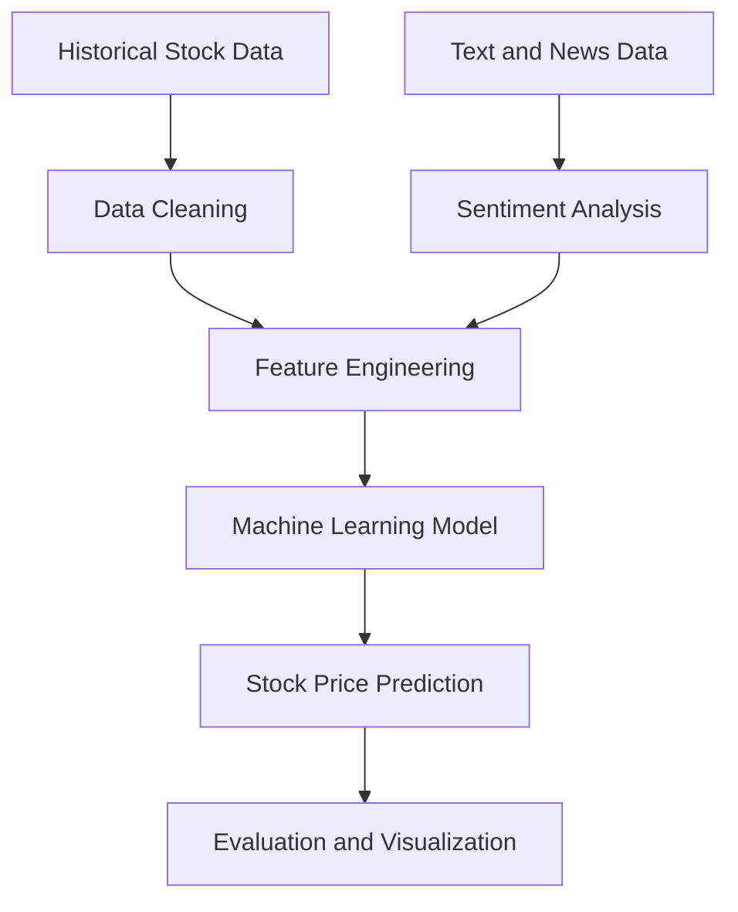
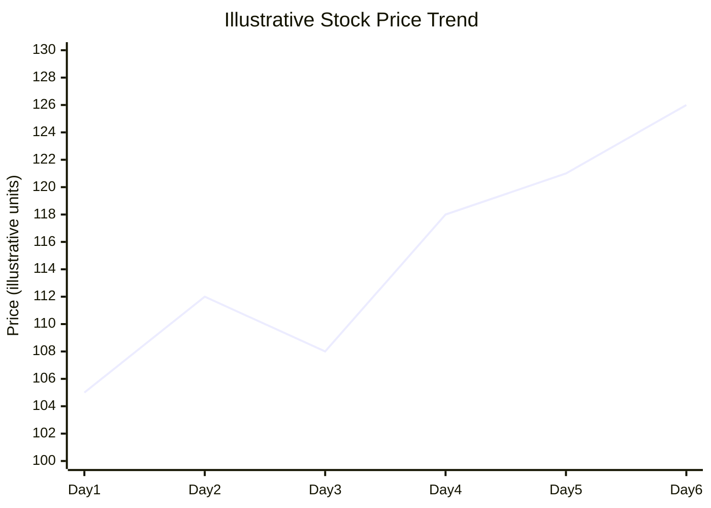

# Stock-Market-Prediction-Web-App-using-Machine-Learning-And-Sentiment-Analysis-master
## Market Analysis and Visualization

Visualizing historical stock prices helps users understand price movements, market trends, and fluctuations over time. Combining numerical market data with sentiment analysis can provide additional context for interpreting market behavior.

## Machine Learning Workflow

## Example Stock Price Trend

The following chart illustrates an example of how historical and predicted stock prices can be visualized. Replace the illustrative values with actual project outputs before using them for evaluation.

## Model Evaluation

Prediction performance can be evaluated by comparing predicted prices with actual prices using Mean Absolute Error (MAE) and Root Mean Squared Error (RMSE). A comparison chart of actual and predicted prices can help reveal how closely the model follows observed market movements.

## Sentiment Analysis Visualization

Sentiment results can be summarized using a bar chart showing the number of positive, neutral, and negative texts. Use the actual sentiment counts generated by the application rather than sample values.

## Limitations

Stock prices are influenced by economic events, company announcements, and investor behavior. Predictions are estimates and do not guarantee future performance. This project is intended for educational purposes and is not financial advice.

## Validation and Risk Notes

Use a chronological train/test split for time-series experiments so future observations do not leak into training. Compare predictions with a simple baseline and report MAE or RMSE on the test period. If text sentiment is used, document the source and timestamp of the text and ensure it was available at prediction time.

This is an educational analysis project, not investment advice. Historical patterns and sentiment signals do not guarantee future market movements.

## Project Development Notes

Use chronological validation to avoid future-data leakage. Document data timestamps, market-data source, sentiment source, and baseline performance; this project is educational, not investment advice.

For reproducible updates, record the dataset or upstream version, environment and dependency versions, configuration, and actual outputs from each run. Keep illustrative examples clearly labelled and never commit credentials or private data.

### Technical Deep Dive

For time-series prediction, use chronological train/validation/test windows rather than a random split. Construct lagged price/volume features using information available at prediction time, and align each news item with its publication timestamp before deriving sentiment features. Compare against simple baselines such as the previous close or a moving average.

Suggested engineering checks: prevent look-ahead leakage, document ticker/data-provider coverage and missing trading days, report MAE/RMSE on a later test period, and label all forecasts as uncertain educational estimates—not investment advice.
